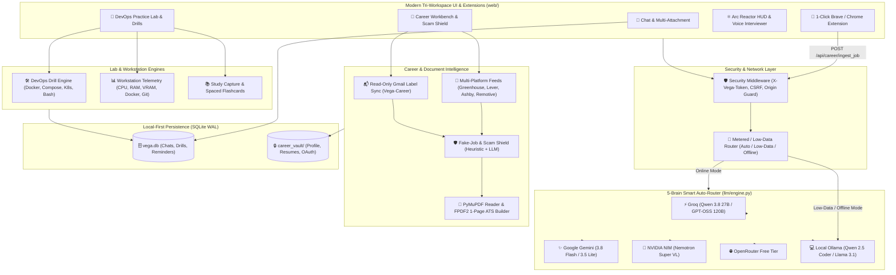

# 🌌 Vega v2.2 — Autonomous Local-First Engineering Workstation, Career Workbench & DevOps Hub

[](https://www.python.org/)
[](.github/workflows/ci.yml)
[](Dockerfile)
[](LICENSE)
[](#-system-architecture)

**Vega v2.2** is a production-grade, local-first AI engineering workstation companion, career advancement workbench, and hands-on DevOps study hub. Built with a modular Python backend and a zero-build Vanilla JS interface, Vega pairs on-device local LLM execution (via Ollama) with multi-cloud intelligence (Gemini 3.8 Flash, Groq, NVIDIA NIM, OpenRouter) to deliver automated career scam protection, ATS-tailored PDF generation, disposable hands-on DevOps simulation, real-time hardware telemetry, and an interactive voice-driven Arc Reactor HUD.

---

## 🏛️ System Architecture



---

## ✨ Feature Highlights

### 1. 🧠 Task-Based 5-Brain Smart Auto-Router & Low-Data Routing
- **Deterministic Cascades**: Maps tasks to optimal providers:
  - `general_chat`: Groq (GPT-OSS 120B) → NVIDIA NIM → Gemini 3.8 Flash → OpenRouter → Local Ollama
  - `scam_shield` & `bulk_scan`: Groq (Qwen 3.8 27B) → Gemini 3.5 Flash Lite → NVIDIA NIM → Local Ollama
  - `resume_tailor` & `long_pdf_analysis`: Gemini 3.8 Flash (1M+ context) → NVIDIA NIM → OpenRouter → Local Ollama
- **Token Ceiling & Vision Guards**: Prompts exceeding 5,500 tokens or containing image attachments automatically bypass Groq and route directly to multimodal flagships.
- **Persistent Network Modes (`auto`, `low_data`, `offline_only`)**:
  - Automatically routes queries to local Ollama (`qwen2.5-coder:7b`) on metered connections.
  - Skips heavy background network polls and serves cached SQLite data instantly.
  - Manual overrides remain available for deliberate cloud queries.

### 2. 🛡️ Career Scam-Shield Workbench & ATS PDF Engine
- **Pre-Emptive Scam Shield**: Inspects job postings for fraudulent domains, fake interview red flags (Telegram, WhatsApp, unverified crypto checks, pay-to-work fees), quarantining high-risk posts into an isolated safety bucket.
- **ATS-Optimized 1-Page Resume Builder**: Generates strictly 1-page PDF resumes using `fpdf2` with clickable GitHub, LinkedIn, and email hyperlinks verified via `PyMuPDF`.
- **Multi-Platform ATS Connectors**: Native parsers for Greenhouse, Lever, and Ashby job boards, alongside Remotive and RemoteOK open feeds with per-board concurrency locking.

### 3. 🧩 1-Click Brave / Chrome Extension & Job Ingestion
- Unpacked browser extension captures open job listings from LinkedIn, Indeed, Naukri, or direct career pages with one click.
- Sends payloads to `/api/career/ingest_job` with active session authentication (`X-Vega-Token`).
- Runs instant Scam Shield evaluation, skill matching against candidate profile vault, and persists opportunities to SQLite.

### 4. 📬 Read-Only Gmail Label Sync & Calendar Deadlines
- **Strict Privacy Scoping**: Uses exclusively `https://www.googleapis.com/auth/gmail.readonly` restricted to the user-configured label (default: `Vega-Career`). Never touches inbox emails outside that label.
- **Automated Deadline Scheduling**: Detects interview confirmations and online assessment (OA) deadlines, creating non-overlapping reminders.
- **Outreach Drafter**: Synthesizes human-in-the-loop connection notes (under 300 characters for LinkedIn) and recruiter follow-ups.

### 5. 🔬 Lab DevOps Drills, System Telemetry & Arc Reactor HUD
- **DevOps Challenge Engine**: Generates real broken configuration drills across Dockerfiles, `docker-compose.yml`, Kubernetes manifests, and Bash scripts with static syntax validation and LLM evaluation.
- **Fault-Isolated Health Checks**: Live CPU, RAM, GPU %, and VRAM telemetry with 3-second timeout protection for Docker Desktop and Git status.
- **Arc Reactor HUD**: Concentric Web Audio API energy rings reacting to microphone volume and TTS output, paired with a 10-minute project-grounded technical mock interviewer.
- **Lecture Flashcard Capture**: Converts raw lecture transcripts or meeting notes into structured bullet takeaways and spaced-repetition Q&A flashcards.

---

## 🚀 Quickstart Guide

### Option A: Windows Local Desktop (Recommended)

1. **Clone the repository:**
   ```powershell
   git clone https://github.com/vega-dev/mybot.git
   cd mybot
   ```

2. **Install dependencies:**
   ```powershell
   python -m pip install -r requirements.txt
   ```

3. **Configure Environment Keys (Optional):**
   Copy `.env.example` to `.env` and fill in API keys:
   ```powershell
   Copy-Item .env.example .env
   ```
   *(Local Ollama works out-of-the-box with zero API keys).*

4. **Launch Vega:**
   - Double-click `Start Vega.bat` or run:
   ```powershell
   python vega_webview.py
   ```
   - Open your browser at `http://127.0.0.1:47632`.

---

### Option B: Headless Docker Backend

Vega can be run inside a lightweight, non-root Docker container on any Linux, macOS, or Windows host:

1. **Build and run with Docker Compose:**
   ```bash
   docker compose up -d --build
   ```

2. **Check container health:**
   ```bash
   curl -f http://localhost:47632/api/health
   # Returns: {"status": "ok", "version": "...", "headless": true}
   ```

3. **Container Features:**
   - Runs as non-root user `vega` (UID 1000).
   - Automatically reaches host-level Ollama daemon via `host.docker.internal:11434`.
   - Persists SQLite state across container restarts via `vega_data` volume.

---

### Option C: 1-Click Brave / Chrome Extension Setup

1. Open **Brave** or **Chrome** and navigate to `brave://extensions` or `chrome://extensions`.
2. Toggle on **Developer mode** (top-right corner).
3. Click **Load unpacked** and select the directory:
   `<your-vega-folder>\browser_extension`
4. The **Vega Career Capture** extension icon will appear in your browser toolbar.
5. While browsing any job board (LinkedIn, Indeed, Greenhouse, etc.), click the Vega icon and select **Capture Job** to stream the listing into your Career Workbench.

---

## 📶 Metered-Connection & Offline-Aware Routing

Vega features an intelligent network-aware inference layer designed for unstable or metered connections:

| Mode | Trigger | Behavior |
| :--- | :--- | :--- |
| **Auto** | Default | Lightweight socket probe checks internet reachable; routes to cloud flagships when online, seamlessly falls back to Ollama when offline. |
| **Low-Data** | Manual / Toggle | Skips remote job feeds, suppresses background Gmail syncing, and directs routine chat & drills directly to local Ollama. |
| **Offline-Only** | Manual / Air-gapped | 100% on-device local inference with local Ollama (`qwen2.5-coder:7b`). Zero external socket calls. |

Toggle modes on the fly via the top-bar dropdown or through the API:
```bash
curl -X POST http://localhost:47632/api/settings/network-mode \
     -H "Content-Type: application/json" \
     -d '{"mode": "low_data"}'
```

---

## 🧹 Fresh Start & Privacy Reset

Vega is engineered with zero hardcoded identity markers. On fresh checkouts or when sharing across multiple machines, Vega boots with zero inherited memories, zero inherited chats, and clean default configurations (`VEGA_USER_NAME="User"`, `VEGA_ASSISTANT_NAME="Vega"`).

To wipe all runtime chat history, memories, SQLite databases, voiceprints, and logs at any time:

### Via UI
1. Open **Settings** (gear icon) in the web interface.
2. Under the bottom actions, click **Reset All Memory & Data**.
3. Confirm the prompt to restore a 100% clean factory slate in 1 second.

### Via Command-Line Utility
```bash
# Interactive confirmation prompt
python scripts/reset_vega_data.py

# Non-interactive / automation flag
python scripts/reset_vega_data.py --yes
```

---

## 🔒 Security, Privacy & Safety Guarantees

- **100% Local-First Persistence**: Conversations, user preferences, and drill histories reside exclusively inside `vega.db` with SQLite Write-Ahead Logging (WAL) and 30-second busy timeout locks.
- **Fact-Locked Career Vault**: Resumes, candidate facts, and Google OAuth credentials live in `career_vault/`, which is strictly ignored by `.gitignore` and `.dockerignore`.
- **Read-Only OAuth Scoping**: Gmail integration requests strictly `gmail.readonly` filtered to a single label (`Vega-Career`), preventing any email modification, sending, or deletion.
- **Human-in-the-Loop Automation**: Vega never auto-submits job applications or performs headless logged-in clicks on external platforms.
- **Secret Leak Guards**: Telemetry monitors scan for `.env` exposures, git uncommitted credentials, and sensitive tokens before broadcasting workstation health.
- **Hermetic CI/CD Verification**: GitHub Actions workflow passes hermetically with `VEGA_CI_MODE=1` without requiring live API keys or external network dependencies.

---

## 🧪 Verification & Automated Testing

Vega includes an 11-phase comprehensive verification suite covering all core subsystems:

```powershell
# Run hermetic test suite (simulating CI environment)
$env:VEGA_CI_MODE="1"; python tests/verify_vega_career.py

# Run static linter
ruff check .

# Verify bytecode compilation
python -m compileall -q -x "(\.venv|venv)" .
```

### Verification Matrix
- ✅ **Phase 0:** Model Hygiene & Centralized Defaults
- ✅ **Phase 1A:** PyMuPDF Reader, Link Extraction & Scan Detection
- ✅ **Phase 1B:** ATS 1-Page PDF Generation & Clickable URI Bounds
- ✅ **Phase 2:** Career Scam Shield & Quarantining
- ✅ **Phase 3:** ATS Connectors, Deduplication & SQLite CRUD
- ✅ **Phase 4:** REST Endpoints & UI Component Smoke Tests
- ✅ **Phase 5:** 5-Brain Auto-Router, Token Ceilings & Provider Badges
- ✅ **Phase 6:** Ashby Parser, Scan Lock Guard & Brave Extension
- ✅ **Phase 7:** Read-Only Gmail Label Sync & Outreach Drafter
- ✅ **Phase 8:** DevOps Drills, Fault-Isolated Health & HUD Interviewer
- ✅ **Phase 9:** Low-Data Routing, Docker Container & GitHub Actions CI

---

## 📄 License

MIT License. See [LICENSE](LICENSE) for details. Built with ❤️ for engineering productivity.
